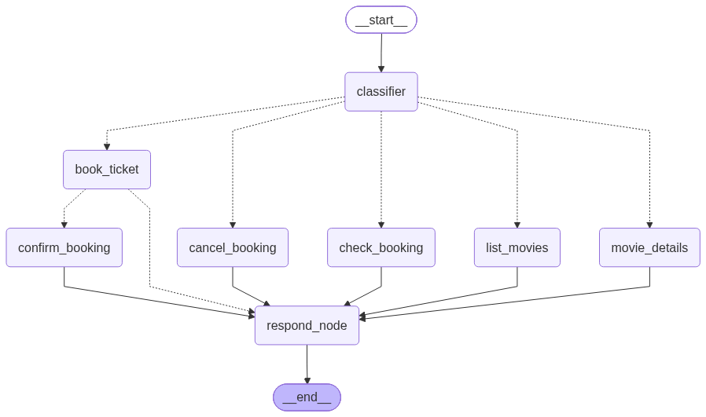

# Book_Agent - Cinema Ticket Booking Agent

A LangGraph-based AI agent for booking cinema movie tickets. It classifies user intent, extracts booking details, checks seat availability, confirms bookings via human-in-the-loop interruption, and supports booking lookup and cancellation.


## DEMO
 

## Features

- **Intent classification** — classifies messages into: `list_movies`, `movie_details`, `book_ticket`, `cancel_booking`, `check_booking`, `return_tickets`, `general`
- **Entity extraction** — movie id/title, customer name, seats, booking id
- **Seat availability check** — prevents overbooking
- **Human-in-the-loop confirmation** — `interrupt()` asks "Confirm Your Booking? Yes / No" before saving
- **Booking lookup & cancellation** — check status or cancel an existing booking
- **SQLite persistence** — movies and bookings stored in `cinema.db`
- **Demo notebook** — `demo.ipynb` with end-to-end flows


## Folder Structure

```
Book_Agent/
├── agent.py              # LangGraph agent: nodes, edges, compiled graph
├── data.py               # Seed movie data
├── models.py             # SQLAlchemy models (Movies, Booking), engine, seed
├── demo.ipynb            # Jupyter notebook with usage examples
├── requirements.txt      # Python dependencies
├── .env.example          # Example environment variables
├── .env                  # Local secrets (gitignored) — create with your GROQ_API_KEY
├── .gitignore            # Git ignore rules
├── cinema.db             # SQLite database (created at runtime)
├── book_agent.db         # SQLite database (created at runtime)
├── readme.md             # This file
├── venv/                 # Virtual environment (gitignored)
├── __pycache__/          # Python cache (gitignored)
└── image.png             # Working photo / architecture diagram (add your own)
```

## Working Photo

Add your working photo / architecture diagram as `Book_Agent/image.png`.

## How It Works

The agent is a `StateGraph` compiled with `InMemorySaver`:

1. **classifier** — LLM (Groq `openai/gpt-oss-20b`) classifies intent and extracts details into `ClassifiedIntent`
2. **route_by_intent** — routes to the matching handler node
3. **Handlers:**
   - `list_movies` — returns all movies with id, title, genre, showtime, price, seats
   - `movie_details` — returns details for one movie by id or title
   - `book_info_node` — validates movie, customer name, seats, and availability
   - `confirm_booking_node` — interrupts for user "Yes / No" confirmation, then writes the booking and decrements seats
   - `respond_node` — LLM formats the raw result into a friendly reply
   - `check_booking_node` — returns booking status/details by booking id
   - `cancel_booking_node` — cancels a confirmed booking and restores seats
4. **respond_node → END**

## Intents & Examples

| Intent | Example |
|--------|---------|
| `list_movies` | "what movies are playing tonight?" |
| `movie_details` | "how much is a ticket for Interstellar?" |
| `book_ticket` | "book 2 tickets for Inception for Alice" |
| `cancel_booking` | "cancel booking 7" |
| `check_booking` | "is booking #3 confirmed?" |
| `return_tickets` | "I'd like to return my tickets, booking 5" |
| `general` | "hi, what can you do?" |

## Setup

```bash
# Clone / open the folder
cd Book_Agent

# Create virtual environment
python -m venv venv
.\venv\Scripts\Activate.ps1   # Windows

# Install dependencies
pip install -r requirements.txt

# Configure environment
copy .env.example .env
# Edit .env and set: GROQ_API_KEY=your_groq_api_key

# Run the demo
jupyter notebook demo.ipynb
```

## Usage Example

```python
from agent import final_graph

# List movies
res = final_graph.invoke(
    {"user_message": "List all the movies"},
    {"configurable": {"thread_id": "1"}},
)
print(res["result"])

# Book a ticket (triggers interrupt for confirmation)
res = final_graph.invoke(
    {"user_message": "I am AMAN, and I want to book a ticket for 'Titanic' and seats required 5"},
    {"configurable": {"thread_id": "1"}},
)

# Resume the interrupt with "yes"
from langgraph.types import Command
res = final_graph.invoke(
    Command(resume="yes"),
    {"configurable": {"thread_id": "1"}},
)
print(res["result"])

# Check booking status
res = final_graph.invoke(
    {"user_message": "booking status for booking id 1"},
    {"configurable": {"thread_id": "1"}},
)
print(res["result"])

# Cancel a booking
res = final_graph.invoke(
    {"user_message": "i want to cancel my booking for booking id 3"},
    {"configurable": {"thread_id": "1"}},
)
print(res["result"])
```

## Requirements

- Python 3.10+
- `langchain`, `langgraph`, `langchain-groq`, `sqlalchemy`, `pydantic`, `python-dotenv`
- A Groq API key

## Environment Variables

| Variable | Description |
|----------|-------------|
| `GROQ_API_KEY` | Your Groq API key (set in `.env`) |

See `.env.example` for the format.
